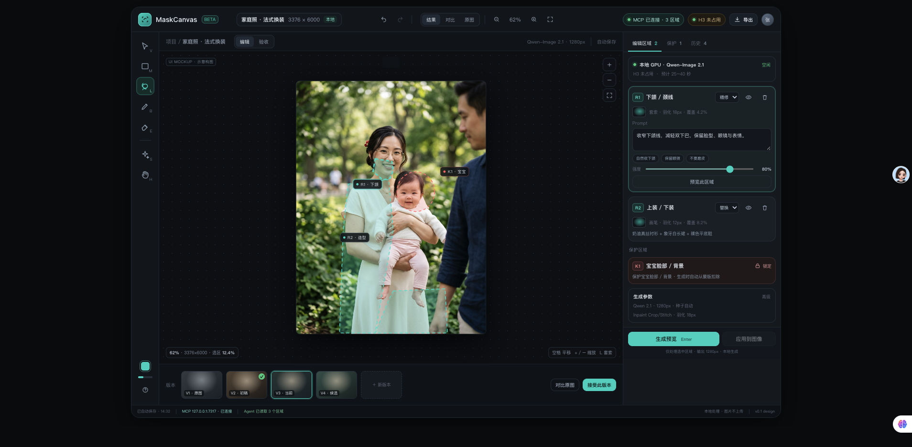
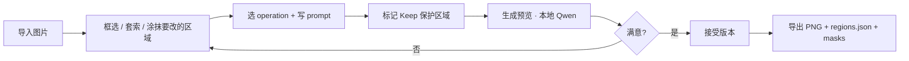
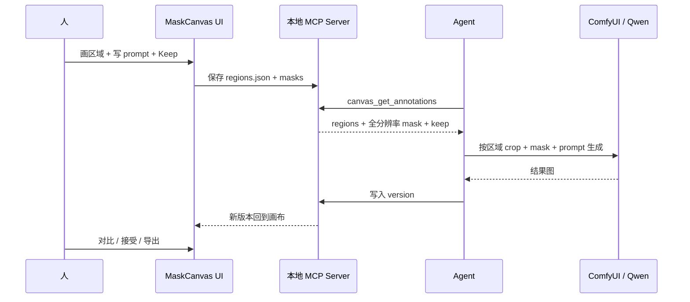
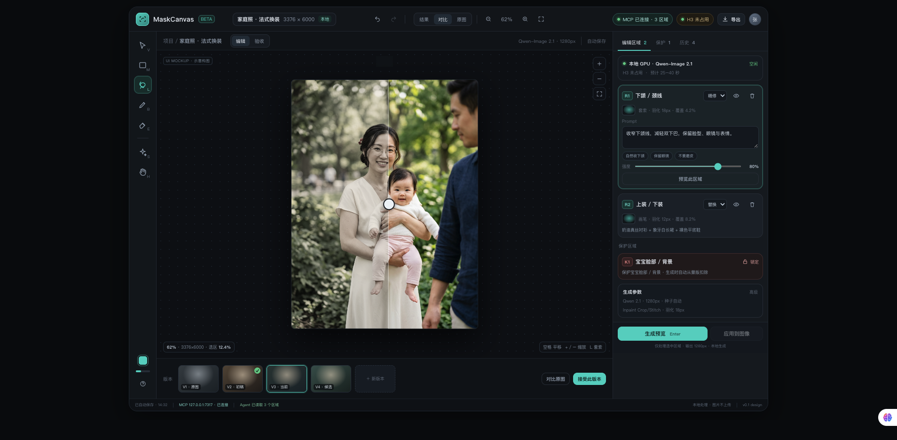
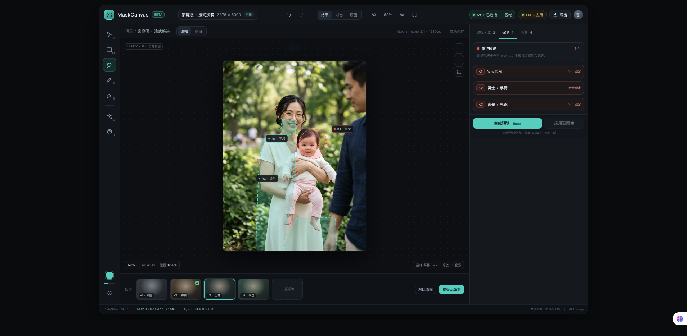

# MaskCanvas

**本地优先的「人工框选 + Agent + Qwen」图像精修工作台。**

在画布上圈出要改的地方，写一句意图，让本地 Qwen 只改那里——每一步都能对比、回退、验收。



> **状态：设计阶段，尚未开始写实现。**
> 本仓库当前是产品简报、UI 规范、交互路线图、技术架构和一份可交互的 UI 稿。没有可运行的代码。

---

## 这是什么

MaskCanvas 是一个独立的图像编辑应用：用户在画布上用矩形、套索、画笔、保护区域标注要改 / 不要改的地方，写上每个区域的意图；本地 MCP 把这些结构化标注交给 Agent，再由 Agent 调用本地 Qwen-Image / ComfyUI 完成精修，结果回到画布做 A/B、版本和验收。

它不绑定 OpenMontage，也不依赖 Photoshop。目标是替代「写一大段 prompt + 手工算 crop/蒙版 + 反复拼图」的流程。

### 要解决的问题

当前的本地 Qwen 精修流程是 prompt-first：人写一段文字描述要改什么 → Agent 猜一个 crop → Qwen 重绘整个 crop → 人再手工做蒙版、羽化、拼回原图 → 出现鬼影、接缝、旧衣服残留，再改 prompt 或重做蒙版。

问题不在模型，而在**意图没有被几何化**：

- 「只改下颌」没有变成 mask；
- 「宝宝不要动」只是一句 prompt，不是硬约束；
- 每次修改都要重写整段描述；
- 生成结果和原图之间没有稳定的版本/对比。

### 核心 job-to-be-done

> 我看到照片里一个具体问题（下颌、发丝、领口、裙边、旧衣服），我想直接圈出来，告诉它「改成什么 / 不要动哪里」，然后马上看到可对比的结果，不满意就改选区再试。

---

## 工作流



Agent 也可以直接介入同一条链路：



---

## 核心概念

| 概念 | 说明 |
|---|---|
| Region | 一个蒙版 + 一个操作（replace / remove / restyle / retouch / keep）+ 一段 prompt |
| Keep region | 保护区域，优先于 prompt；生成和合成时都不会被改 |
| Version | 每次生成的版本，带 seed、分辨率、prompt、耗时、接受状态 |
| Job | 一次 Qwen / ComfyUI 任务，有 queued / running / succeeded / failed / cancelled 状态 |
| Agent bridge | 本地 MCP server，把 `regions.json` 和全分辨率 mask 暴露给 Agent |

三条硬规则：

1. **Keep 优先**：`protect: true` 的蒙版从编辑并集中扣除，它不是 prompt，是几何约束。
2. **原图不可变**：任何生成都产出新版本，原图永远保留，删除只隐藏版本。
3. **区域级意图**：每个 region 独立 operation / prompt / seed，不做整图 prompt。

---

## 界面

UI 稿是纯前端静态稿（无后端、无真实生成），用于确认布局、信息层级和交互。图片是示意构图，不是实际家庭照。

| 默认编辑状态 | 分割对比 | 保护区域 |
|---|---|---|
|  |  |  |

- 布局：`Top bar 56px` + `Tool rail 64px` + `Canvas stage` + `Inspector 380px` + `Status bar 28px`，设计基准 1440×900，桌面优先。
- 颜色即语义：青色 = 要编辑，珊瑚红 = 保护，琥珀 = 队列/警告，绿色 = 成功。
- 可交互稿：[`design/ui-mockup.html`](design/ui-mockup.html) —— 单文件、无后端，双击打开或本地起静态服务即可点击工具、区域卡、对比、Protect/History 标签、生成按钮、导出弹层。

---

## 技术方向（待实现）

| 层 | 选型 |
|---|---|
| 前端 | React + Vite + TypeScript + Konva（画布）+ Zustand + Tailwind |
| 本地服务 | TypeScript MCP server + HTTP/WebSocket；浏览器只连 `127.0.0.1` |
| 生成 | ComfyUI HTTP API（Qwen-Image-2.1 Turbo），优先 `Inpaint Crop/Stitch`，退回裁切 + 合成 |
| 存储 | 本地 project 目录 + `source.png` / `regions.json` / `masks/` / `versions/` |
| 隐私 | 所有图片、蒙版、结果都在本机；无云上传、无遥测 |
| 可选 | SAM2 点选/框选自动出蒙版（P1） |

```text
┌──────────────────────────────┐
│ Browser (127.0.0.1)          │
│ React + Vite + Konva         │
│ canvas / masks / regions     │
└──────────────┬───────────────┘
               │ HTTP + WS (session token)
┌──────────────▼───────────────┐
│ MaskCanvas local server      │
│ static UI · project store    │
│ job queue · MCP server       │
└──────────────┬───────────────┘
               │ HTTP
┌──────────────▼───────────────┐
│ ComfyUI (local / tailnet)    │
│ Qwen-Image-2.1 Turbo         │
│ Inpaint Crop/Stitch          │
└──────────────────────────────┘
```

---

## 范围

**P0（MVP）**：导入图片 · 矩形/套索/画笔/橡皮 + 羽化 · 区域级 operation/prompt/强度/keep · 本地 Qwen 生成与区域预览 · 前后对比、版本列表、接受版本 · 导出 PNG/JPG + `regions.json` + masks · 本地 MCP server 暴露 annotations。

**P1**：SAM2 自动蒙版 · 多区域队列 + 独立 seed · 历史回滚、区域复制、快捷键完善 · 项目自动保存/恢复 · Photoshop UXP / Krita 适配器。

**P2**：批量模板 · Agent 自动建区域与任务面板 · 项目库与局域网共享 · 更多本地模型（FLUX Kontext、Qwen 2511 等）。

**非目标**：不做完整 Photoshop 替代（图层混合、印刷、矢量、3D），不做视频编辑/生成，不做云端协作/账号体系，不默认上传任何图片到第三方服务。

---

## 仓库结构

```text
MaskCanvas/
  README.md
  docs/
    product-brief.md          # 产品简报：定位、用户、范围、关键决策
    ui-spec.md                # UI 规范：布局、组件、design tokens、状态
    interaction-roadmap.md    # 交互路线图：主流程、生命周期、快捷键、边界情况
    architecture.md           # 技术架构：组件、regions.json、MCP 接口、Qwen 适配
  design/
    README.md                 # 设计文件说明
    ui-mockup.html            # 可交互 UI 稿（单文件、无后端）
    ui-mockup.png             # 默认编辑状态
    ui-mockup-compare.png     # 分割对比
    ui-mockup-protect.png     # 保护区域
    portrait-placeholder.png  # 合成人像占位图，不含真实人物
```

---

## 隐私

这是本项目的第一约束，不是附加项：

- UI 和 MCP 都只绑定 `127.0.0.1`，默认不监听 `0.0.0.0`，带 per-session token。
- 无遥测、无外部字体/CDN、无云调用。
- 项目文件存在本地 `~/Pictures/MaskCanvas/<project>/`，仓库内 `projects/` 已被忽略。
- 不把图片字节或 prompt 写到任何外部服务。
- 导出默认剥离敏感 EXIF（可选保留）。
- `portrait-placeholder.png` 是为 UI 稿生成的合成人像示意图，不包含任何真实人物。

---

## 路线图

| 阶段 | 内容 | 估算 |
|---|---|---|
| Phase 0 — 设计确认（当前） | UI 稿、UI spec、交互路线图、架构 | — |
| Phase 1 — 画布骨架 | Vite + React + Konva；导入、缩放平移、四种选区工具、区域卡片、本地持久化 | 2–3 天 |
| Phase 2 — MCP + Qwen | MCP server、ComfyUI 适配器、job 状态与排队 | 3–4 天 |
| Phase 3 — 版本/对比/导出 | 版本列表、分割对比、接受版本、导出、快捷键、异常状态 | 2 天 |
| Phase 4 — 增强（P1） | SAM2、多区域队列、历史回滚、PS/Krita 适配器 | 5–7 天 |
| Phase 5 — 批量/团队（P2） | 批量模板、项目库、局域网共享、更多模型 | 2–3 周 |

Phase 1 的退出标准：能画 3 个区域、保存、重开恢复。P0 完整验收标准见 [`docs/interaction-roadmap.md`](docs/interaction-roadmap.md#p0-验收标准)。

---

## 成功标准

| 指标 | 目标 |
|---|---|
| 首次编辑到第一次预览 | < 60 秒（GPU 空闲） |
| 单区域预览耗时 | 15–45 秒（1280px，3050 级别 GPU） |
| 需要手工算 crop/坐标 | 0 次 |
| 每次修改的可对比性 | 任意版本可 A/B，原图永远保留 |
| 隐私 | 0 次云上传（默认配置） |
| 一次验收通过率 | P0 阶段先记录基线，不设虚高目标 |

---

## License

[MIT](LICENSE) © 2026 John Zhang