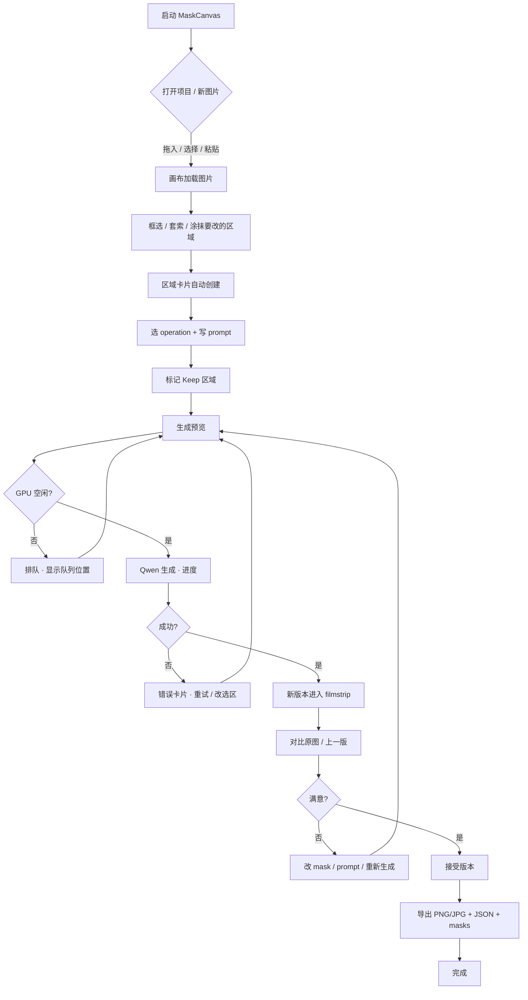
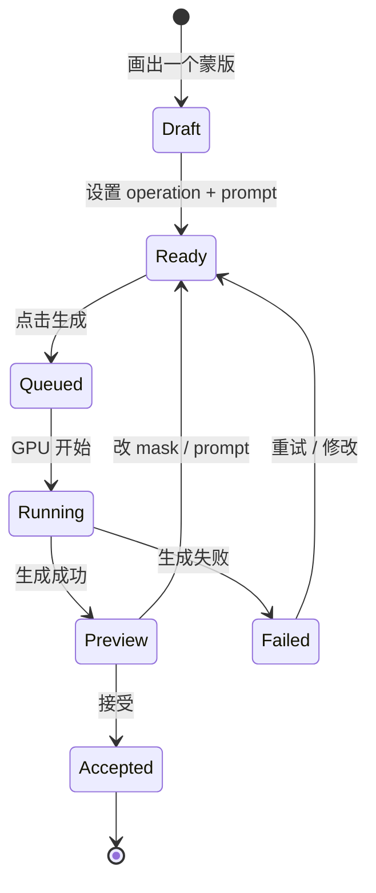
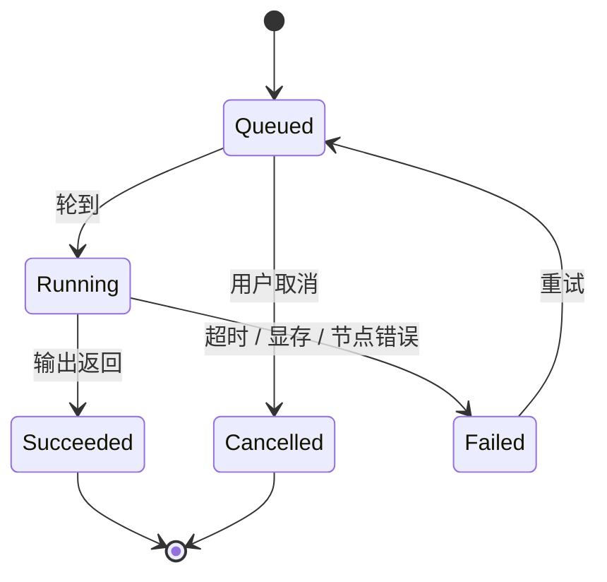
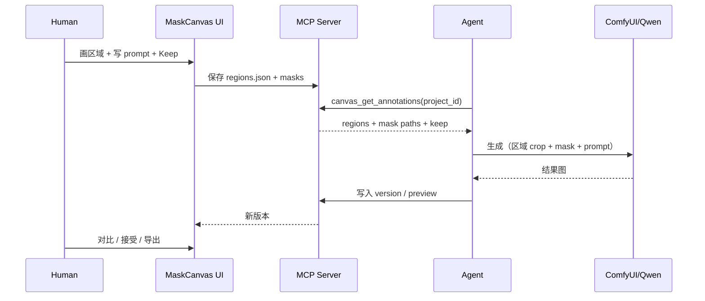

# MaskCanvas — Interaction Roadmap

## 主流程

## 区域生命周期

## Job 生命周期

## 屏幕与交互

### 1. 启动 / 项目

- 中央 dropzone：`拖入一张图片，或从剪贴板粘贴`。
- 最近项目列表：缩略图、名字、最后修改时间。
- 底部：`本地运行 · 图片不会上传`。
- 交互：拖入即创建项目并进入编辑器；点击最近项目恢复上次的 regions/versions。

### 2. 编辑器空状态

- 画布显示图片，左上角 coach mark：`框选要修改的区域`。
- 右侧 Inspector 显示三张引导卡：`框选` → `写意图` → `预览`。
- 工具 rail 高亮套索；用户可直接画。

### 3. 画区域

- 选择矩形/套索/画笔；画的时候实时显示青色半透明蒙版。
- 松开鼠标：
  - 创建 region，默认 operation = `精修`；
  - Inspector 自动滚动到新卡片，prompt 聚焦；
  - 画布上出现 `R1` chip。
- 套索双击闭合；画笔支持 `[` `]` 调整大小；橡皮擦除当前蒙版。
- 误画：`Cmd+Z` 撤销；删除卡片即删除区域。

### 4. 写意图

- operation 下拉：精修 / 替换 / 移除 / 换装 / 保护。
- prompt 输入框；右侧/下方显示建议 chips（按 operation 变化）。
- 强度、羽化滑杆；`保护` 开关。
- 多选区域时，Inspector 顶部显示 `已选 2 个区域`，主按钮变 `预览选中区域`。
- 区域重叠：画布上叠加显示；生成时按 z-order 合并编辑 mask，Keep 区域优先扣除；冲突时提示。

### 5. 生成预览

- 点击 `生成预览` / Enter。
- Job card 进入 `排队` 或 `生成中`；画布顶部显示细进度条。
- GPU 被 H3 占用时：`前面还有 1 个 H3 任务，预计 3 分钟`；不自动打断 H3。
- 生成中锁定该区域的 mask 编辑（可继续画其他区域，但需提示“当前版本生成中”）。
- 取消：只取消自己的 job；不调用 `/interrupt` 去杀 H3。

### 6. 对比

- 成功后新版本自动进入 filmstrip，画布显示结果。
- 对比模式：
  - 分割：中央手柄，左原图 / 右结果；拖动或方向键移动。
  - 切换：按住 `\` 看原图。
  - 100% 放大检查：工具栏 `100%`；画布以鼠标位置为中心。
- 对比对象可选：原图 / 上一版 / 已接受版。

### 7. 修改与重试

- 改 mask：直接画/擦；卡片显示 `已修改，未生成`。
- 改 prompt：卡片显示 `有未应用的修改`；`Cmd+Enter` 重新生成。
- 失败：Job card 红色，保留 mask/prompt；按钮 `重试`。
- 版本可以并存，不覆盖；原图 V1 永远保留。

### 8. 接受与导出

- `接受此版本`：filmstrip 缩略图出现绿色 ✓；导出默认使用该版本。
- `应用到图像`：把当前预览写入基础图，创建新版本（也可理解为“接受并继续编辑”）。
- 导出弹层：PNG/JPG、原尺寸/长边 4096/2048、附带 regions.json + masks + versions.json。
- 导出路径默认 `~/Pictures/MaskCanvas/<project>/`；可改。

### 9. Agent 交接

- 顶部 Agent 胶囊：`MCP 已连接 · 3 区域`；点开显示：
  - MCP endpoint（`127.0.0.1:7317/mcp`）
  - 项目 ID
  - `复制 regions.json`
  - `复制 Agent 启动命令`
- Agent 读取后，胶囊短暂显示 `Agent 已读取 3 个区域`。
- Agent 创建的 region 标记为 `Agent`，人类可以修改/删除。

## 快捷键

| 快捷键 | 动作 |
|---|---|
| `V` / `M` / `L` / `B` / `E` / `S` / `H` | 选择 / 矩形 / 套索 / 画笔 / 橡皮 / 智能选择 / 抓手 |
| `Space` 拖拽 | 平移 |
| `[` / `]` | 画笔大小 |
| `+` / `-` | 缩放 |
| `0` | 适应窗口 |
| `1` | 100% |
| `Cmd/Ctrl+Z` / `Shift+Cmd/Ctrl+Z` | 撤销 / 重做 |
| `Delete` | 删除选中区域 |
| `Enter` / `Cmd+Enter` | 生成预览 |
| `\`（按住） | 临时看原图 |
| `Cmd/Ctrl+S` | 导出 |
| `?` | 快捷键帮助 |

## 边界情况

| 情况 | 行为 |
|---|---|
| 蒙版为空/太小 | 禁止生成；提示 `请画出至少 1% 的区域` |
| 蒙版过大（>80%） | 警告 `这几乎会重绘整张图`；建议拆区域 |
| 蒙版反转 | 工具栏提供 `反选`；Keep 区域仍优先 |
| 区域重叠 | 编辑区域取并集；Keep 区域从并集中扣除；冲突时列出冲突区域 |
| 多区域同时生成 | 顺序队列；每个区域独立 seed；避免一次改太多导致身份漂移 |
| 生成中改 mask | 允许画但标记 `未应用`；不修改正在运行的 job |
| 生成失败 | 保留输入；显示错误码/摘要；可重试 |
| Agent 断开 | UI 仍可本地编辑/生成；顶部灰色提示；重连后同步 |
| Agent 并发写 region | 版本化；人类编辑优先；冲突弹窗（P1） |
| 图片过大 | 画布用降采样预览；mask 以原尺寸保存；导出原尺寸 |
| EXIF 方向 | 导入时归一化；导出不写敏感 EXIF |
| 非 sRGB / CMYK | 转 sRGB 后编辑；提示颜色可能变化 |
| 本地服务未启动 | 只读模式 + `启动本地服务` 命令 |

## 实施路线

### Phase 0 — 设计确认（当前）

- 产出：本 UI 稿、UI spec、交互路线图、架构。
- 退出标准：布局、区域卡片、对比/版本、Agent 交接方式确认。

### Phase 1 — 画布骨架（2–3 天）

- Vite + React + TS + Konva。
- 导入图片、缩放/平移、矩形/套索/画笔/橡皮。
- Region 卡片、operation/prompt、Keep。
- 本地持久化（project 目录 + regions.json + masks）。
- 退出标准：能画 3 个区域、保存、重开恢复。

### Phase 2 — MCP + Qwen（3–4 天）

- MCP server：canvas_open/get_annotations/export_mask/qwen_apply/wait。
- ComfyUI adapter：Qwen-Image-2.1，`Inpaint Crop/Stitch`，失败回退裁切+合成。
- Job 状态、排队、取消、错误。
- 退出标准：一条真实链路“框选下颌 → 生成 → 回画布”跑通。

### Phase 3 — 版本/对比/导出（2 天）

- 版本列表、分割对比、接受版本、导出 PNG/JPG+JSON+masks。
- 快捷键、自动保存、空/错/忙状态。
- 退出标准：完整 P0 可用；一次家庭照下颌精修验收。

### Phase 4 — 增强（P1，5–7 天）

- SAM2 点选/框选。
- 多区域队列、独立 seed、历史回滚。
- Photoshop UXP / Krita 适配器。
- Agent 创建区域、冲突处理。

### Phase 5 — 批量/团队（P2，2–3 周）

- 批量模板、项目库、局域网共享、更多模型。

> 估算前提：1 名熟悉 React/ComfyUI 的开发者；本地 Qwen/ComfyUI 已可用；不做账号/云同步。实际以 canary 结果调整。

## P0 验收标准

- [ ] 导入 3376×6000 图片，画布流畅缩放/平移。
- [ ] 矩形/套索/画笔能生成区域；Keep 区域可见且优先。
- [ ] 每个区域可写 prompt、选 operation、调强度。
- [ ] 点击生成后能看到排队/进度/成功/失败状态。
- [ ] 生成结果进入版本列表，可分割对比原图。
- [ ] 可接受版本并导出 PNG + regions.json + masks。
- [ ] Agent 能通过 MCP 读取 3 个区域并触发一次生成。
- [ ] 全程无云上传；图片只在本机/本地 GPU。
