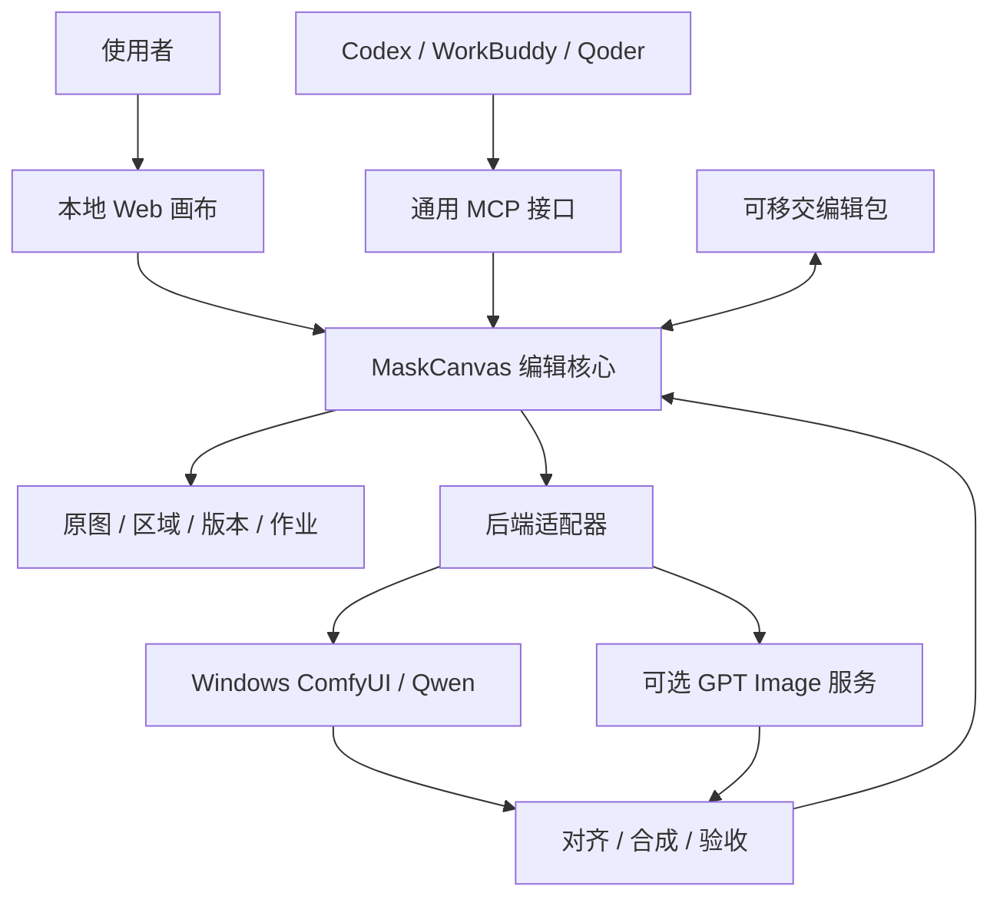

# MaskCanvas 实现形态与需求研究

日期：2026-10-21。状态：**研究建议，待需求确认；不表示已实现或已通过出图验证。**

## 结论

建议将产品定义为：**供人和不同 AI Agent 共用的照片局部编辑工作台，以可验证的编辑数据为中心，接入本地 Qwen 和可选 GPT Image 后端。**

交付形式建议是本地 Web 工作台、独立编辑核心、通用 MCP 和可移交编辑包。客户端安装配置与简短 Skill 是接入层；原生桌面壳和 Photoshop/Krita 插件可后加。首版不内置另一套聊天 Agent，直接使用用户已有的 Codex、WorkBuddy、Qoder。

**产品独立不等于画布必须全部重写。** 优先对 ComfyUI-InpaintCanvas 做适配性验证，再决定沿用其画布、作为可选执行器，还是实现 MaskCanvas 自有画布。不能在尚未试验时声称现成工具已经满足全部需求，也不能忽略已有工具直接重造。

三种使用方式都属于核心需求：人工标注后移交、人和 Agent 协同、Agent 在授权任务内自主识别并编辑。自主建区和无需人工打开画布的执行能力应从第一版接口考虑；高级批量、复杂自动美学判断可以后续增强。

## 证据与本轮边界

| 项目 | 实际检查 | 能证明什么 / 不能证明什么 |
|---|---|---|
| 项目文档 | 读取 README、产品简报、架构、交互路线图 | 当前仍是设计阶段；既有范围偏 Qwen 与人工标注 |
| Qoder 来源 | 读取会话 `48b2902b-d93c-4b38-b264-e7a0bfdad53b` 的用户消息、总结及相关答复 | 还原需求来源和失败案例；历史任务成功陈述不作为当前运行验收 |
| Windows ComfyUI | 本轮 GET `/system_stats`、`/queue`、`/object_info`、模型列表 | ComfyUI 0.42.1，RTX 3050 8GB；检查时队列为空；节点和模型已登记 |
| Qwen | 列出 Image 2.1 普通版、Turbo、编码器、VAE；发现 `TextEncodeQwenImage21` | 具备接入基础；未重新提交生成，不能据此承诺耗时和效果 |
| 选区辅助 | MediaPipe 人脸关键点/面部 mask 节点与模型已登记 | 面部局部辅助可研究；不能代替头发、服装、完整人物分割 |
| GPT 自定义节点 | `CLIProxyAPIGPTImage2` 有 2.5 Flare/Sunburst 等选项与 edit 模式 | 只有可选 `image`，没有 `mask` 输入；不能当现成精确 inpaint 接口 |
| GPT 官方节点 | `OpenAIGPTImageNodeV2` 有 2.5 模型与 mask 输入 | 节点存在；实际账号、费用、远端链路、编辑成功率未验证 |
| 裁切与拼回 | 发现 `InpaintCropExtractor`、`InpaintStitcher`、`SimpleInpaintCrop`、`SimpleInpaintStitch` | 有候选基础；不能仅凭名称认为其合成满足保护约束 |
| 资料研究 | Context7 查询 ComfyUI 与 MCP；打开官方客户端文档、开源仓库与 MCP 说明 | 支持协议与选型判断；没有安装或运行这些候选软件 |
| 多模型评审 | web-ai MCP DeepSeek 两轮研究与纠偏 | 意见由主 Agent 对照来源复核；不作为效果测试 |
| Gemini | 只读 `gemini_models` 返回 `browser_error`；检查会话列表与 ego task space 状态 | 未取得可用的 Gemini 4 标识，也未取得本轮研究答复；没有反复提交或改用别的型号冒充 |

本轮没有上传私人照片、提交图像生成、安装依赖、重启服务或修改用户配置。仅新增本研究文档，未将建议覆盖为既定需求。

## 从 Qoder 会话提取的真实需求

原始任务来自日常家庭照修饰，后续涉及眼神、下颌、发型、身形和服装。用户明确希望模型实际参与编辑，并非只有传统磨皮或几何变形。

| 历史反馈 | 应进入产品的需求 |
|---|---|
| 下颌像被裁断 | 生成上下文涵盖下颌与颈肩；检查裁切边界和轮廓连续性 |
| 脸部有虚影 | 关键面部不能把两套不对齐轮廓直接透明混合；候选与原图分开保存 |
| 旧衣服在脖子、腰部、人物遮挡处残留 | 显示实际可修改范围与保护范围；检查新旧轮廓并集、遮挡和覆盖缺口 |
| 有明显拼接痕迹 | 同时检查坐标对齐、颜色、纹理和轮廓；不能只扩大羽化 |
| 旁人和宝宝要保留 | 保存明确保护 mask，并按 mask 全域验收，而不是仅凭提示词 |
| 不断文字描述、看不见到底改哪里 | 可见选区、局部意图、原尺寸对比、修改记录、明确失败原因 |

照片“变好看”与照片“重设计”应分开表达。去瑕疵、曝光和肤色属于修饰；放大眼睛、瘦脸、换发型或换装涉及外观改变，应由任务意图指定。Agent 不应把这些视为所有照片的默认美化步骤。

## 实现形式比较

| 形式 | 对当前目标的价值 | 局限 | 建议 |
|---|---|---|---|
| 本地 Web + 编辑核心 + MCP | 同一项目同时服务画布与 Agent；跨客户端接入；便于离线移交 | 需处理大图、色彩、存储与任务生命周期 | 推荐的产品边界 |
| ComfyUI 插件 + MCP | 最直接复用 Windows 推理、选区和生成链路 | 与 ComfyUI 前端/工作流耦合；任务和项目格式需评估 | 优先验证现成候选 |
| Krita/Photoshop 插件 | 成熟的像素工具、画笔、图层和摄影工作习惯 | 依赖宿主；跨 Agent、远程执行和统一交接仍需桥接 | 专业用户可选入口 |
| Codex/WorkBuddy/Qoder 专用插件 | 各自可提供贴近宿主的入口 | 三套生命周期与 UI 适配；容易重复维护 | 配置/包装即可，不做三套编辑器 |
| 纯 MCP / 纯 Skill | 方便 Agent 调用 | 人工精准选区和原尺寸检查缺入口；Skill 本身不负责像素执行 | MCP 必需，但不是完整产品 |
| Tauri/Electron 原生壳 | 安装、文件关联和系统集成方便 | 不能解决核心精修质量；增加打包成本 | 核心验证后再选择 |

### 已找到的现成候选

以下为上游文档能力，均未在本机安装验收。

| 候选 | 与需求直接相关的能力 | 适配判断 |
|---|---|---|
| [ComfyUI-InpaintCanvas](https://github.com/DenRakEiw/ComfyUI-InpaintCanvas) | 选区画布、crop/mask、本地/API 双链路、图层、MCP | 首选试验；需核实保护、完整交接与并发语义 |
| [Kokon](https://github.com/GabrieleLozupone/kokon) | Qwen 2.1 本地应用和 MCP；使用 stable-diffusion.cpp | 会新增推理栈；8GB 为 beta，12GB 为最低常规配置；不是直接复用现有 ComfyUI |
| [Slojka](https://github.com/HelpFreedom/slojka/blob/main/README.md) | 图层、选区、SAM 2.1、MCP | 编辑器方向接近；现有生成接 polza.ai，本地 ComfyUI 需另适配 |
| [Krita AI Diffusion](https://github.com/Acly/krita-ai-diffusion) | 选择区域编辑、区域意图、历史和生成工作流 | 成熟绘画入口备选；本轮未证明其原生支持目标双后端与完整 Agent 交接 |

InpaintCanvas 的 [MCP 文档](https://github.com/DenRakEiw/ComfyUI-InpaintCanvas/blob/master/mcp/README.md) 还提供无人值守模式，但它通过后台 Chromium 运行前端，并非纯后端像素服务。其命令路由限制 localhost；跨 Mac/Windows 不能直接假设 Mac MCP 能远程调用，需要 Windows 侧桥接。截图用于观察，像素差分必须用无损导出。

复用方式应先选外部适配。MaskCanvas 当前为 MIT；InpaintCanvas、Krita AI Diffusion 为 GPL，Kokon 为 AGPL，Slojka 仓库有 GPL 许可证。直接复制或派生代码前须核对许可证义务，不能直接把上游代码标为本项目 MIT。

## “像素级精准”的可执行定义

建议对用户承诺：**编辑边界可以精确控制，候选内容可以逐像素检查，保护区可以用程序证明没有改变；编辑内容的自然程度仍需验收。**

[OpenAI 图像编辑文档](https://developers.openai.com/api/docs/guides/image-generation#edit-an-image-using-a-mask) 明确说明 mask 是生成引导，模型未必精确遵循边界。因此两个后端都只能产生候选素材，最终可改范围由 MaskCanvas 合成器强制执行。

需要分开保存三种范围：

1. **允许编辑范围 E**：人或已授权 Agent 明确允许改变的像素。
2. **上下文范围 C**：发给模型参考的较大 crop，可以包含旁人或背景，但不等于允许修改。
3. **保护范围 K**：优先于 E，最终必须恢复基准像素的区域。

最终 alpha 的非零范围必须完全落在 `E - K` 内。羽化向内收；如果效果需要扩大 E，先把范围变化作为计划更新。羽化、校色、重采样或其他处理之后仍要执行最终保护检查。

设 B 为本次方向、尺寸、色彩已经归一化的不可变基准版本，G 为对齐后的候选，A 为有效 alpha：

```text
A = inward_feather(edit_mask) × (1 - binary_keep_mask)
result = composite(B, G, A)
result[A == 0] = B[A == 0]
result[K] = B[K]
```

这只是约束示意，不是算法实现。重叠区、alpha 精度、预乘方式与色彩空间需要在实际合成器内统一。

验收时比较相同尺寸、相同色彩处理的无损像素数组，分别报告 `protected_changed_pixels`、`outside_edit_changed_pixels`、`max_channel_delta`。声明零变化时前两项必须为零；还要确认保护 mask 本身覆盖了真正应保护的对象。

JPEG 重编码、整图调色、整图超分与这一零差分承诺不兼容，应成为单独的派生导出或另一项明确授权操作。面部身份、发丝自然度、服装残留、姿态与美感不能由零差分证明。也不能用 SSIM 高分或另一模型的“看起来不错”替代真实局部验收。

换装、换发型尤其需要覆盖新旧轮廓，并处理原本被挡住的背景。严格保护相邻物体时，若缺少可编辑空间导致无缝结果不可得，应报告冲突、请求调整范围，不能静默侵入保护区。

## 建议架构



建议控制端运行在用户正在使用 Agent 的电脑上，管理项目和本地画布；Windows 是已有 ComfyUI 执行节点。前端只连接控制端，跨设备上传/下载由适配器负责，避免在 UI 里直接拼接 Windows 路径或暴露上游凭据。

产品中把任务计划、蒙版、裁切、候选、版本和验收定义为统一对象。后端差异留在适配器，不把核心工具命名为 `qwen_apply`、`qwen_wait`。

本地客户端优先 stdio 接入同一个编辑核心；有可靠需求再开放认证的 Streamable HTTP。stdio 包装不能为每个 Agent 启动彼此独立的项目库或 GPU 队列。

[Codex MCP](https://learn.chatgpt.com/docs/extend/mcp)、[Qoder MCP](https://docs.qoder.com/cli/mcp-reference) 和 [WorkBuddy Connector](https://open.workbuddy.cn/en/docs/connector) 的官方资料均支持这一接入方向；它们不证明本机三个客户端已经完成联调。MCP Apps 的 [宿主支持存在差异](https://modelcontextprotocol.org/extensions/apps/overview)，画布应能在普通浏览器独立运行，内嵌面板作为增强。

### 图像与意图的分工

| 执行方 | 职责 |
|---|---|
| Agent | 理解目标、查看允许的图像、提出编辑计划、选择区域与方法、判断候选、决定下一步 |
| 画布 | 人工精细画 mask、修正 Agent 区域、展示进度与差异、选择接受版本 |
| 编辑核心 | 坐标变换、范围约束、合成、版本冲突检查、作业持久化、交接包与确定性验收 |
| 本地分割/检测 | 将点、框、部件描述转为实际 mask；输出置信与失败信息 |
| Qwen / GPT Image | 生成候选内容；不能直接绕过编辑核心覆盖原图 |

Agent 的粗框不能当作最终发丝/衣领 mask。建议基础工具支持点、框、画笔和直接导入 mask，分割器作为可替换能力；自动模式遇到无法可靠分离的遮挡应停止或交给人修正。

## 三种模式共用一条链路

| 模式 | 最小闭环 | 人的介入 |
|---|---|---|
| 人工标注后移交 | 导入 → 编辑/保护 mask → 局部意图 → 导出包 → 任一 Agent 执行 → 结果包回导 | 标注时和需要时验收；不要求标注者与执行者同时在线 |
| 人与 Agent 协同 | Agent 提出问题/选区 → 人修正 → 生成候选 → 局部对比 → 接受或重试 | 双方操作同一个项目；画布显示计划与实际进度 |
| Agent 自主 | 读取任务边界 → 观察与分割 → 建区 → 生成 → 硬约束检查与视觉评估 → 限额重试 → 输出结果 | 正常执行不逐步打断；越界、低置信或预算耗尽才请求介入 |

三者使用相同的 base version、region、mask、job、candidate 和 validation，不能分别实现三套修图管线。

人工编辑标注正在变化时，后台任务使用提交时冻结的快照。结果返回后若基准版本改变，保留为候选分支并提示冲突，不能 last-write-wins 静默盖掉后续编辑。初版线性版本链加分支候选即可，不必先实现复杂通用 DAG 编辑器。

自主模式并不等于默认全图、所有人物、无限循环。每个任务明确对象、允许操作、保护对象、可用后端和有限重试次数；自动接受仅在任务授权与已达到的验收条件内执行。无法可靠自动判断时输出候选与失败原因。

## 建议 MCP 能力边界

以下为拟议能力组，名称尚未冻结，**当前并不存在这些可执行工具**。

| 能力组 | 最小职责 |
|---|---|
| 能力发现 | 后端是否可用、是否本地、mask/参考图支持、图像观察与分割能力 |
| 项目与观察 | 导入资产、取得项目状态、获取允许共享的预览和原尺寸局部 crop |
| 区域与计划 | 增删修改 region、导入 mask、根据点框请求分割、读取人工标注、冻结编辑计划 |
| 作业 | 提交、短时返回 job ID、查状态、取消本项目自己的作业、读取错误 |
| 候选与版本 | 查看候选、合成验证、接受/拒绝、回到历史版本 |
| 交接 | 导入/导出编辑包、导出照片、输出验收报告 |

公共输入包含 `project_id`、`base_version`、`annotation_revision` 和资产引用；任务提交带幂等 ID。返回结构化 JSON 和可选图像内容，不能只返回人类看得懂的长段描述或不可访问的绝对路径。

不同客户端未必都能直接看 MCP 图像资源。需要验证实际图像输入能力；无视觉能力时仍可执行已有完整标注包，不能声称已自主识别或完成视觉验收。

作业查询与取消独立于生成调用，避免单个 MCP 调用长等 GPU。与 H3 等共享队列时不得全局 interrupt、清空队列或释放别人的模型；恢复查询不得重复提交任务。状态不能确认时显示待核对，而不是擅自判失败后重发。

## 可移交编辑包

先使用有 schema 版本的目录或 ZIP，名称可以暂定 `maskcanvas-edit.zip`。它不是现有行业标准，也不需要先开发专有二进制格式。

```text
edit-package/
  manifest.json
  assets/base.png
  annotations/regions.json
  masks/edit-*.png
  masks/keep-*.png
  previews/overview.png
  instructions/task.json
  results/                 # 执行后可添加
  reports/validation.json  # 执行后可添加
```

最少字段：schema 版本、资产相对路径与哈希、基准版本、方向/尺寸/色彩信息、mask 白黑语义、原图坐标、区域意图、操作顺序、允许后端、保护范围、任务预算。结果包增加实际工作流/模型标识、种子（若支持）、输入快照、候选哈希与验收结果。

mask 使用无损全分辨率文件；矩形/笔画可附带用于再次编辑，但不能只有截图或 CSS 屏幕坐标。内部统一白色表示“编辑/保护强度”，适配器负责转换 GPT alpha mask 等外部约定。

包内不放凭据、API token 或强依赖某台电脑的绝对路径。导入检查哈希、schema、图像尺寸、mask 配对和 ZIP 路径越界；不执行包内脚本。不承诺跨后端逐像素复现生成，保存输入与产物用于追踪和重新编辑。

## 双后端与隐私边界

| 项目 | Qwen Image 本地路线 | GPT Image 2.5 路线 |
|---|---|---|
| 推理位置 | 可在 Windows GPU 执行；工作流不能夹带未授权云节点 | 本地节点不等于本地推理；须标明实际服务路径 |
| 已有基础 | 模型和相关节点已登记 | 自定义与官方节点已登记，mask 能力不同 |
| 产品角色 | 私人照片默认候选生成后端 | 在允许远端处理时可选；不能静默兜底 |
| 验收 | 相同的裁切、合成和保护检查 | 相同的裁切、合成和保护检查 |
| 尚待验证 | 代表性照片成功率、身份保持、耗时/显存 | 账号与额度、编辑/mask实际支持、费用、稳定性和数据边界 |

本地生成也不代表端到端不外传：Codex、WorkBuddy、Qoder 的视觉模型若在远端，Agent 获取原图/crop/缩略图仍可能把照片交给远端模型。产品应区分“生成允许的目的地”和“分析允许的目的地”。

严格私密模式下，外部 Agent 可处理结构化标注与非图像状态；照片观察、分割与生成均由已验证的本地组件完成，或由人工提供完整标注。本机 Qwen3-VL 编码器存在不等于已经有独立可调用的照片分析服务。MediaPipe 是人脸检测/关键点工具，也不是通用修图审美 Agent。

本轮只向 DeepSeek 发送抽象产品需求和失败类型，没有发送私人照片、Qoder 原始会话文件或凭据。

## 建议先验证什么，再决定开发范围

此表为下一阶段建议，**本轮尚未执行**。

| 试验 | 验证方法 | 决策依据 |
|---|---|---|
| 现成画布适配 | InpaintCanvas 接一条 Qwen 和一条已授权 GPT 编辑链路；使用非私人测试图 | 若画布可复用，先适配，不先重写 |
| 三客户端 | 分别用 MCP 完成同一个导入、建区、查作业、取结果流程 | 工具调用和图片观察能力分别记录，不以“支持 MCP”代替联调 |
| 自动模式 | 无人工开画布条件下处理一个明确目标；有限重试，异常可恢复 | 是否真的无需人在旁边点按钮；后台浏览器依赖是否可接受 |
| 精确边界 | 同尺寸 PNG 测试：keep、mask 外、mask 重叠、向内羽化、空 mask、越界 mask | 保护区和编辑范围外零变化；非法输入明确失败 |
| 遮挡与美观 | 非私人合成多人照，覆盖下颌、发际、衣领、手臂遮挡、旧衣残留 | 硬约束通过之外，原尺寸查看局部自然度 |
| 交接包 | A 客户端导出、B 客户端执行、回导候选；搬到另一目录 | 不依赖原机绝对路径，不丢 mask/意图/版本 |
| 本机资源 | 记录 Qwen 不同 crop 尺寸的实际耗时与峰值显存 | 用本机数据设预览指标；现文档 15–45 秒只是目标 |

建议阶段顺序：

1. 确认精度、隐私和三模式定义；完成现成工具差距试验。
2. 冻结最小编辑包与领域对象，先通过保护/坐标/合成测试。
3. 跑通 Qwen 与可选 GPT 后端、异步作业、版本与失败恢复。
4. 人工、协同、自主三模式共用闭环，并逐个客户端验收。
5. 根据实际使用再增加 RAW/16-bit/完整 ICC 工作流、专业图层交换、桌面壳与批量。

首版建议支持 JPEG/PNG 导入、方向归一化、明确的 sRGB 工作基准和 PNG 无损验收。保留原始文件；不能悄悄丢弃输入色彩配置，无法解释的配置应报明限制。专业 RAW 显影和印刷色彩能力应单独确认，避免把“摄影精修”误写成“完整 Photoshop 替代”。

## 现有文档待确认的调整

| 现有写法 | 建议调整 |
|---|---|
| 人工框选 + Agent + Qwen | 人与 Agent 共享的精修工作台，支持人工、协同、自主三模式 |
| Agent 自动建区为 P2 | 基础建区与无人工执行从首版支持；高级自动化后续增强 |
| `qwen_apply / qwen_wait` | 模型无关的编辑/作业接口，Qwen 是后端之一 |
| 图片不出本机、无云调用 | 明确个人设备传输、生成远端与分析远端三种边界 |
| 默认更大羽化与拼回 | 有效 alpha 范围、keep 最终恢复、单一轮廓来源与视觉检查 |
| annotations + 绝对 mask 路径 | 可移交包与资产引用；同机绝对路径仅为可选便利 |
| 相同 seed 可复现 | 保存完整输入、工作流及产物；不保证跨环境/服务逐像素重现 |
| last-write-wins | 版本与标注 revision 检查，冲突保留候选而非自动覆盖 |

本研究建议先作为需求讨论依据，不直接重写 README、产品简报或既有 UI 稿。

## 后续需要确认的少量产品选择

1. 日常私人照片是否默认严格本地，GPT 和远端视觉只在项目允许时启用？
2. 第一批成功案例偏去瑕疵、自然人像精修，还是换装/换发型等明显重设计？
3. 第一版面向自己的 Mac 控制端 + Windows GPU，还是同时面向他人独立安装？

不论这些选择如何，三模式、可移交包与精确边界都应保留。具体技术栈、开发工期与“最佳后端”需等差距试验后确定。
